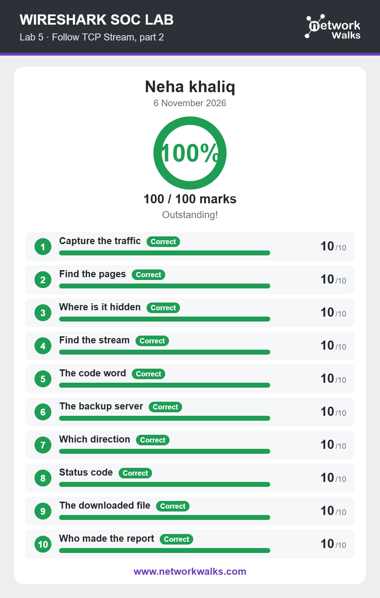

# Lab 05: Follow TCP Stream, Part 2

## Overview
This lab provided further practice with Wireshark's Follow TCP Stream feature using a different network capture. The focus was on examining network conversations and finding hidden data within the captured communication.

## Objectives
- Improve understanding of TCP stream analysis.
- Investigate a different network traffic capture.
- Learn how to inspect information exchanged through TCP.
- Identify hidden data within network communication.

## Activities Performed
- Loaded the new packet capture into Wireshark.
- Examined TCP packets and their communication details.
- Applied the Follow TCP Stream feature.
- Reconstructed the captured network conversation.
- Investigated the communication to locate hidden data.

## Tools Used
- Wireshark
- Follow TCP Stream
- Network Packet Capture (PCAP)

## Skills Gained
- TCP Stream Investigation
- Hidden Data Identification
- Network Traffic Inspection
- Packet Analysis
- Data Investigation

## Learning Outcome
Developed stronger practical skills in TCP stream investigation and learned how to examine network conversations to discover hidden information.

## Lab Results
The screenshot below shows the final result of the completed lab.

