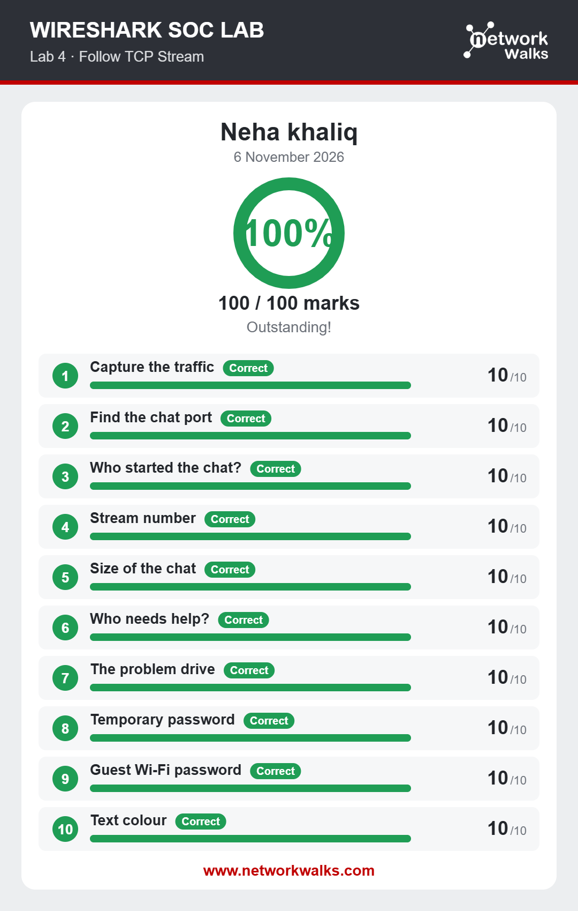

# Lab 04: Follow TCP Stream 1

## Overview
This lab focused on analyzing TCP communication using Wireshark. The main task was to reconstruct a network conversation and examine the data exchanged between communicating systems.

## Objectives
- Understand TCP communication.
- Learn how TCP packets carry information.
- Explore the Follow TCP Stream feature.
- Reconstruct and examine network conversations.

## Activities Performed
- Opened the provided network capture in Wireshark.
- Identified TCP packets in the captured traffic.
- Used the Follow TCP Stream feature.
- Reconstructed the communication between systems.
- Examined the transmitted data and investigated the conversation.

## Tools Used
- Wireshark
- Network Packet Capture (PCAP)

## Skills Gained
- TCP Stream Analysis
- Network Conversation Reconstruction
- Packet Inspection
- TCP Communication Analysis

## Learning Outcome
Learned how to use Wireshark's Follow TCP Stream feature to reconstruct network conversations and understand the information exchanged between systems.

## Lab Results
The screenshot below shows the final result of the completed lab.

