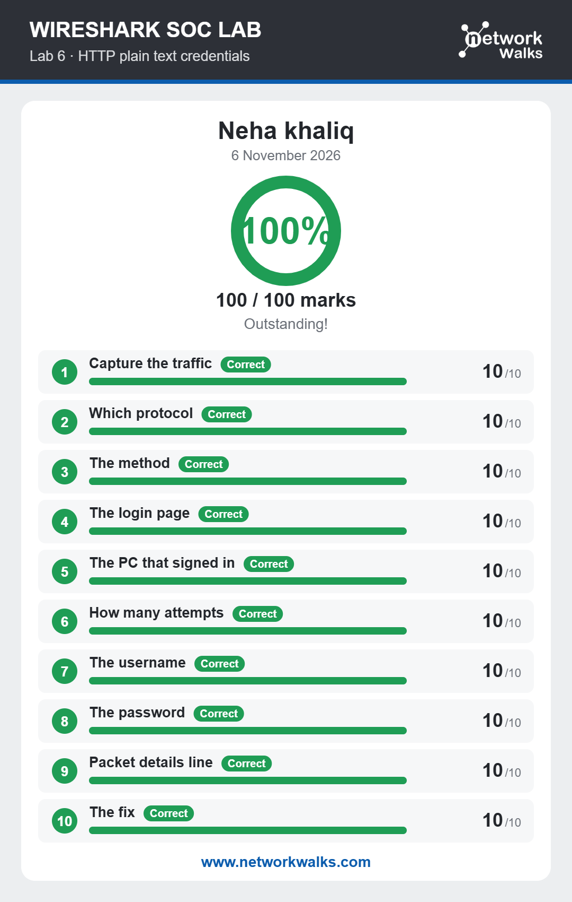

# Lab 06: HTTP Plain Text Credentials

## Overview
This lab focused on analyzing HTTP traffic to identify usernames and passwords transmitted in plain text. It demonstrated how unencrypted communication can expose sensitive login information.

## Objectives
- Understand HTTP traffic analysis.
- Identify credentials transmitted through HTTP.
- Learn how to inspect HTTP requests.
- Understand the security risks of unencrypted communication.

## Activities Performed
- Opened the provided packet capture in Wireshark.
- Examined HTTP packets and requests.
- Inspected the contents of HTTP communication.
- Investigated login-related information in captured traffic.
- Identified usernames and passwords transmitted in plain text.

## Tools Used
- Wireshark
- HTTP Protocol Analysis
- Network Packet Capture (PCAP)

## Skills Gained
- HTTP Traffic Analysis
- HTTP Request Inspection
- Credential Exposure Detection
- Packet Filtering
- Web Security Awareness

## Learning Outcome
Understood how usernames and passwords can be exposed through unencrypted HTTP communication and why HTTPS is important for protecting sensitive information.

## Lab Results
The screenshot below shows the final result of the completed lab.

