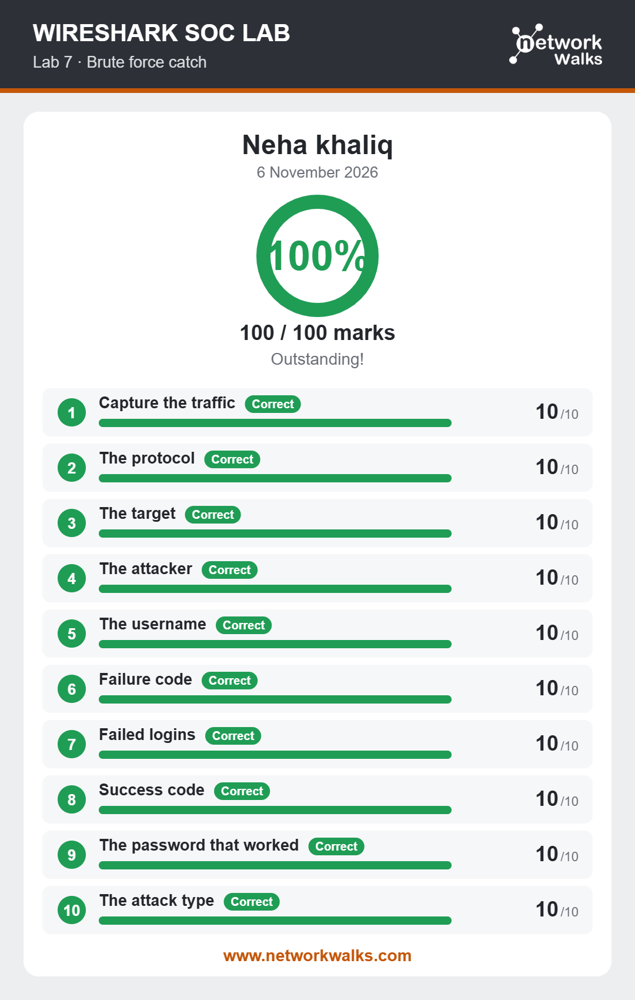

# Lab 07: Catch the Brute Force Attacker

## Overview
This lab focused on investigating brute-force attacks through network traffic analysis. The objective was to identify repeated login attempts and find the source responsible for password-guessing activity.

## Objectives
- Understand how brute-force attacks work.
- Recognize repeated login attempts.
- Identify suspicious authentication patterns.
- Investigate the source of brute-force activity.

## Activities Performed
- Opened the provided network capture in Wireshark.
- Examined authentication-related network traffic.
- Investigated repeated login attempts.
- Observed suspicious password-guessing patterns.
- Identified the attacker responsible for the repeated attempts.

## Tools Used
- Wireshark
- Network Packet Capture (PCAP)

## Skills Gained
- Brute Force Attack Detection
- Authentication Traffic Analysis
- Suspicious Activity Identification
- Attacker Investigation
- Network Security Monitoring

## Learning Outcome
Learned how to recognize brute-force attacks by examining repeated login attempts and investigating suspicious authentication traffic.

## Lab Results
The screenshot below shows the final result of the completed lab.

