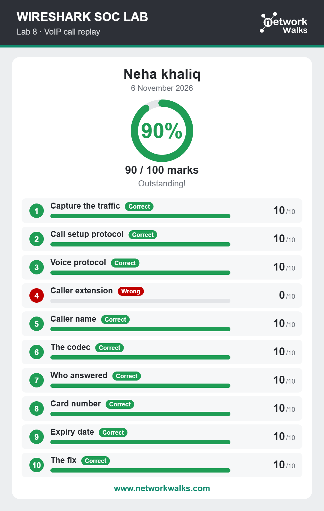

# Lab 08: Catch the Call Scammer

## Overview
This lab focused on investigating a suspicious phone call through network traffic analysis. It involved examining the provided capture, playing the recorded call, and identifying the scammer through the investigation.

## Objectives
- Understand basic VoIP communication.
- Investigate call-related network traffic.
- Examine recorded call audio.
- Identify suspicious communication and the scammer.

## Activities Performed
- Opened the provided network capture in Wireshark.
- Investigated the captured call-related traffic.
- Located and played the recorded call.
- Listened to the conversation and examined its context.
- Used the available information to identify the scammer.

## Tools Used
- Wireshark
- Network Packet Capture (PCAP)
- Recorded Call Audio

## Skills Gained
- VoIP Traffic Investigation
- Network Packet Analysis
- Audio Communication Analysis
- Suspicious Communication Identification
- Digital Investigation

## Learning Outcome
Gained practical experience in investigating call-related network traffic and analyzing recorded communication to identify potential scam activity.

## Lab Results
The screenshot below shows the final result of the completed lab.

